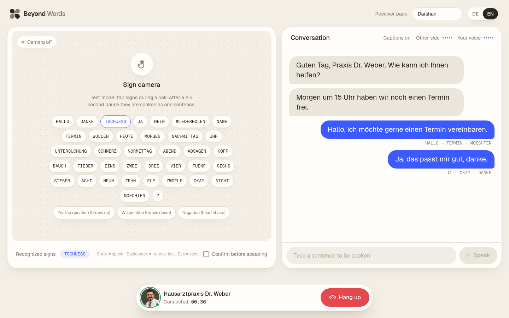
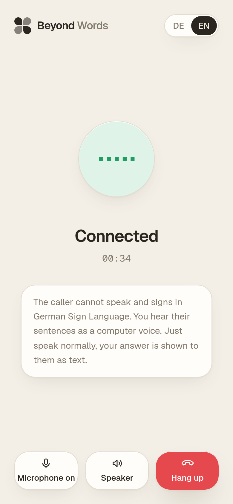

# Beyond Words

**Phone calls for people who cannot speak.** Sign in German Sign Language (DGS) in front of your webcam. The other person hears a natural German voice, and what they answer appears to you as text.

Built in 24 hours at MagdeHack.



## How it works

```
 Caller (laptop)                                         Other side (any phone)
 ┌───────────────┐   signs    ┌──────────┐   voice    ┌──────────────────────┐
 │ webcam        │ ─────────► │ sentence │ ─────────► │ hears a German voice │
 │ reads captions│ ◄───────── │ captions │ ◄───────── │ just speaks normally │
 └───────────────┘    text    └──────────┘   speech   └──────────────────────┘
```

1. **See** – MediaPipe tracks hands, body and face in the browser. No video leaves the laptop.
2. **Recognise** – a small neural network turns each movement into a sign, e.g. `HALLO · TERMIN · MOECHTEN`.
3. **Phrase** – an LLM turns the signs into one natural sentence: *"Hallo, ich möchte gerne einen Termin vereinbaren."*
4. **Speak** – ElevenLabs reads the sentence aloud into the call.
5. **Listen** – the other person's answer is transcribed live and shown as text.

The other side needs no app and no account. They open a link and tap **Join**.



## Features

- Browser-to-browser call, nothing to install
- 36 signs: greetings, appointments, times, numbers 1–12, symptoms
- Continuous signing: a short stop in the air separates two signs
- Raised brows make a question, a head shake makes a negation
- Optional "confirm before speaking", or simply type a sentence instead
- German and English interface

The demo is a doctor's appointment, but the idea is general: order food, book a taxi, call the hairdresser.

## Run it

You need Node.js, Python 3.12 and [ngrok](https://ngrok.com) (for the phone link).

```bash
# 1. Keys: create .env in the repo root (see the list below)
# 2. Install
cd web && npm ci && ln -s ../.env .env && cd ..
cd sign && python3.12 -m venv .venv && .venv/bin/pip install -r requirements.txt && cd ..
# 3. Start everything
./run.sh            # Windows: .\run.cmd
```

The script starts the sign service, the web app and the phone tunnel, opens the caller page and prints the link for the phone. `./stop.sh` stops everything.

`.env` keys: `LIVEKIT_URL`, `LIVEKIT_API_KEY`, `LIVEKIT_API_SECRET`, `ELEVEN_LABS_API_KEY`, `ELEVEN_LABS_VOICE_ID`, `OPENROUTER_API_KEY`, `LLM_MODEL`, `NGROK_AUTH_TOKEN`.

No camera at hand? Open `http://localhost:3000/?mock=1` and tap the signs instead (this is what the screenshot above shows).

## Built with

| Part | Technology |
| --- | --- |
| Web app | Next.js, React, TypeScript, Tailwind CSS |
| Call | LiveKit (WebRTC) |
| Hand, body and face tracking | MediaPipe, in the browser |
| Sign recognition | PyTorch 1D-CNN behind FastAPI (`sign/`) |
| Signs → sentence | Gemma via OpenRouter |
| Voice and live captions | ElevenLabs TTS and Scribe |

## Project layout

```
web/    the app: caller page (/), receiver page (/callee), recording page (/record)
sign/   sign recognition service, training script and the trained model
```

## Limits

- The model knows 36 signs and was trained on one signer, so it makes mistakes with other people.
- It recognises single signs, not full DGS grammar.
- It needs internet: the call, the voice and the sentence model are cloud services.

Reference sign videos on the recording page come from [SignDict](https://signdict.org).
